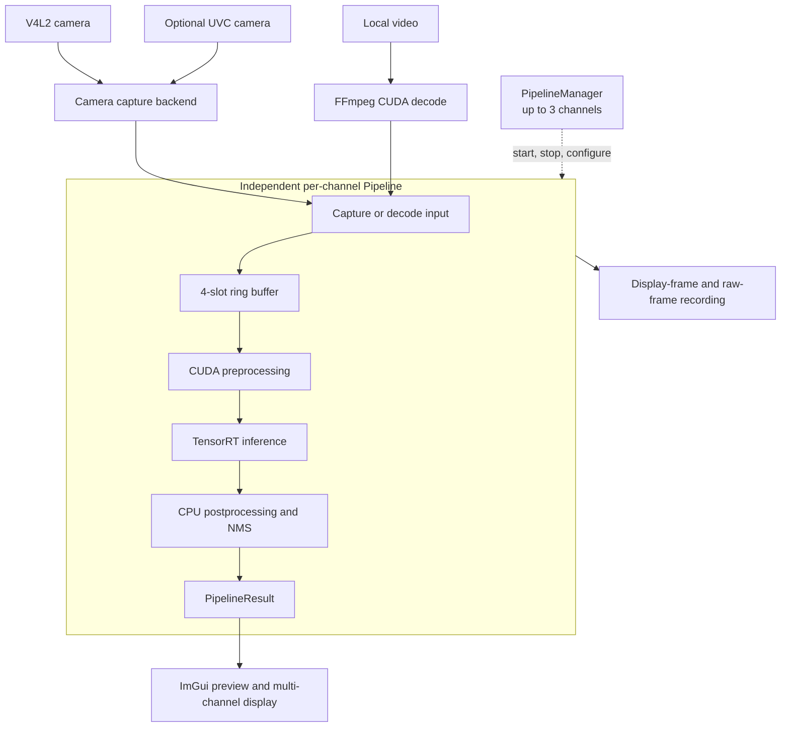
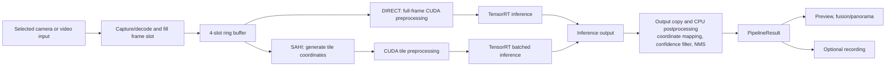

# CUDA/TensorRT Multi-Stream Vision Pipeline

[中文](README.md) | **English**

A multi-input real-time vision pipeline for Linux and NVIDIA GPUs. It connects camera or video inputs to GPU preprocessing, TensorRT inference, postprocessing, GUI display, and recording.

> The current code targets Linux with NVIDIA CUDA and TensorRT. TensorRT engine plans are tied to GPU and TensorRT versions. Model weights, ONNX files, and engine plans are not included.

## Features and author contributions

| Area | Implementation |
| --- | --- |
| Multi-input capture | V4L2 DMA-BUF, CUDA-pinned, and fallback paths; FFmpeg CUDA video decode; optional system libuvc support. |
| GPU pipeline | Custom CUDA preprocessing for NV12, YUYV, and BGR plus FP16/FP32 conversion; per-channel CUDA streams, events, and a four-slot ring buffer. |
| Detection | TensorRT engine shape parsing; DIRECT and SAHI tiled inference, coordinate mapping, and result merging. |
| Display and recording | Dear ImGui multi-channel controls, fusion/panorama views, GPU monitoring, and display/raw-frame recording. |

These modules were implemented by the project author. The diagrams below adapt the system overview and multi-channel design from the supplied slides to the current source. No frame-rate or accuracy guarantee is published until revalidated against this source version.

## Architecture Overview



Each pipeline owns its inference engine, execution context, and frame buffers. Decode/transfer, preprocessing, inference, and postprocessing use separate CUDA streams, with events coordinating frame-slot reuse. The GUI reads the latest result under a mutex. Camera transfer uses DMA-BUF, CUDA-pinned memory, or a fallback copy path depending on device support.

## Per-Frame Data Flow



The SAHI inference path is implemented in code and currently requires a YOLOv5-compatible 640×640 FP32 engine; its GUI mode selector is hidden. See the [architecture guide](docs/architecture.md) for the component map and implementation details.

### Project Design Slides

Selected project background, solution, system architecture, and multi-channel processing slides: [architecture highlights PDF](docs/portfolio/project-architecture-highlights.pdf) (original pages 2, 3, 5, and 8). Treat performance figures as goals or results under the conditions stated in the source material, not as general guarantees.

## Build

Requirements: CMake 3.18+, a C++17 compiler, CUDA Toolkit, TensorRT 10, NVIDIA driver/NVDEC, OpenCV, FFmpeg development libraries, GLFW, OpenGL, and pkg-config. CMake enables optional UVC input when the system libuvc development package is installed.

```bash
cmake -S . -B build \
  -DCMAKE_CUDA_COMPILER=/path/to/cuda/bin/nvcc \
  -DCMAKE_CUDA_ARCHITECTURES=120 \
  -DTENSORRT_ROOT=/path/to/TensorRT
cmake --build build -j
```

Set paths and the CUDA architecture for your system. See the [build guide](docs/building.md) for dependency details and diagnostics.

## Run

```bash
./build/yolov5_sahi
```

Select a local TensorRT engine and input source in the GUI. `engine_inspect` inspects engine metadata and can run an inference smoke check. `camera_bench` measures capture, preprocessing, and inference paths when a V4L2 device is available. Model conversion instructions are in `tools/convert_model.py`.

## License and contributions

First-party project code is licensed under MIT. Third-party terms are listed in [THIRD_PARTY_NOTICES.md](THIRD_PARTY_NOTICES.md). Issues and focused contributions are welcome; see [CONTRIBUTING.md](CONTRIBUTING.md).
