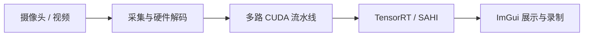

# CUDA/TensorRT Multi-Stream Vision Pipeline

**中文** | [English](README.en.md)

面向 Linux/NVIDIA GPU 的多路实时视觉检测示例。项目把摄像头或视频输入、GPU 预处理、TensorRT 推理、后处理、GUI 展示和录制组织成可并行运行的流水线。

> 当前代码面向 Linux 与 NVIDIA CUDA/TensorRT 环境。TensorRT engine 与 GPU、TensorRT 版本有关；仓库不包含模型权重、ONNX 或 engine 文件。

## 能力与作者贡献

| 能力 | 项目实现 |
| --- | --- |
| 多路采集 | V4L2 摄像头 DMA-BUF/CUDA pinned/fallback 路径；FFmpeg CUDA 视频解码；可选系统 libuvc 支持。 |
| GPU 流水线 | 自定义 NV12、YUYV、BGR CUDA 前处理与 FP16/FP32 转换；多 CUDA stream、CUDA event 与四槽 ring buffer 协调每路工作。 |
| 检测 | TensorRT engine 输入/输出形状解析；DIRECT 与 SAHI 切片推理、结果映射和合并。 |
| 展示与存储 | Dear ImGui 多通道控制、融合/拼接展示、GPU 状态面板，以及显示帧和原始帧录制。 |

以上模块由项目作者实现。各模块位置与数据流见[架构说明](docs/architecture.md)。目前不发布未经当前版本复核的帧率或精度承诺。



## 构建

依赖：CMake 3.18+、C++17 编译器、CUDA Toolkit、TensorRT 10、NVIDIA 驱动/NVDEC、OpenCV、FFmpeg 开发库、GLFW、OpenGL 和 pkg-config。若系统安装 libuvc 开发库，CMake 会启用可选 UVC 输入。

```bash
cmake -S . -B build \
  -DCMAKE_CUDA_COMPILER=/path/to/cuda/bin/nvcc \
  -DCMAKE_CUDA_ARCHITECTURES=120 \
  -DTENSORRT_ROOT=/path/to/TensorRT
cmake --build build -j
```

根据本机 Toolkit、GPU 架构和 TensorRT 安装路径调整参数。完整依赖和诊断命令见[构建指南](docs/building.md)。

## 运行

```bash
./build/yolov5_sahi
```

在 GUI 中选择本地 TensorRT engine 和输入源。`engine_inspect` 可检查 engine 元数据并进行推理 smoke check；`camera_bench` 用于有 V4L2 设备时测量采集、预处理和推理路径。模型转换脚本见 `tools/convert_model.py`。

## 开源与贡献

项目自有代码使用 MIT License；第三方组件及其许可见 [THIRD_PARTY_NOTICES.md](THIRD_PARTY_NOTICES.md)。欢迎提交问题与改进，详见 [CONTRIBUTING.md](CONTRIBUTING.md)。
