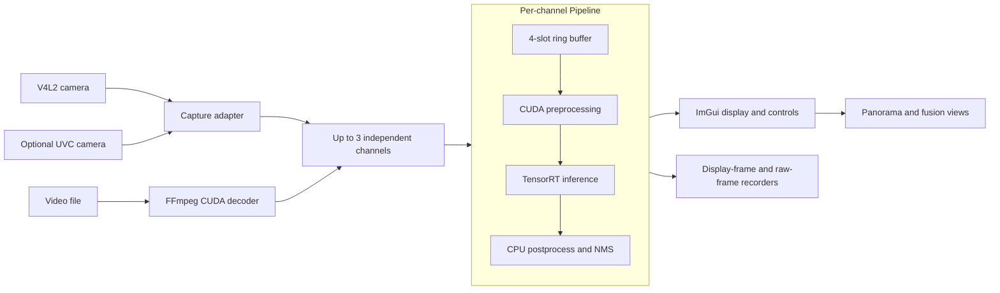
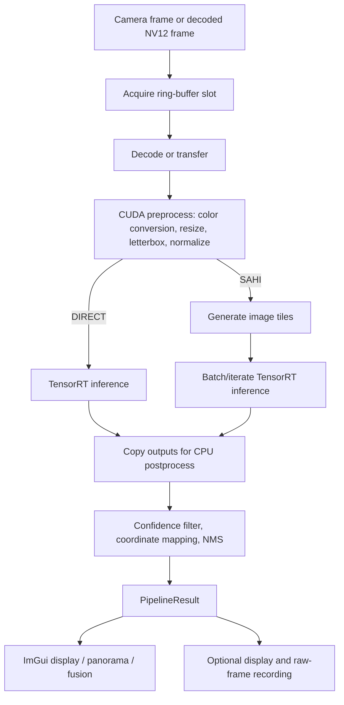

# Architecture / 系统架构

本页按当前 CMake target 与源码整理。每路输入由独立 Pipeline worker 处理；CUDA stream/event 在阶段间异步衔接，四槽 ring buffer 保护帧缓冲复用。

## System overview / 总体框架

摄像头输入在 DMA-BUF 可用时可导入 GPU；其他路径使用 pinned-memory 或显式拷贝。视频输入由 FFmpeg 硬件解码输出 GPU NV12 帧。UVC 依赖系统 libuvc，可选启用。

## Per-channel data flow / 单路处理流程

DIRECT/OFF display paths can keep resize and color conversion on the GPU; SAHI and recording paths may transfer image data to CPU memory. Exact behavior depends on the selected input and mode.

## Author-built components / 作者实现

| Component | Source areas | Contribution |
| --- | --- | --- |
| Capture and decode | `src/v4l2_capture.cpp`, `src/ffmpeg_hw_decoder.cpp`, `src/uvc_capture.cpp` | Camera buffer import/fallbacks and asynchronous video/camera ingestion. |
| Preprocessing and tensor formats | `src/cuda_preprocess.cu`, `src/cuda_postprocess.cu` | CUDA pixel conversion, resize/letterbox, tensor formatting, and FP16/FP32 conversion kernels. |
| Scheduling and inference | `src/pipeline.cpp`, `src/ring_buffer.cpp`, `src/detection_engine.cpp`, `src/sahi_slicer.cpp` | Per-channel stage scheduling, reusable frame slots, TensorRT integration, CPU postprocess, tiled inference and merge. |
| Operator experience | `src/app_gui.cpp`, `src/pipeline_manager.cpp`, `src/video_recorder.cpp`, `src/hw_recorder.cpp` | Multi-channel controls, visualization, monitoring, and recording. |

Performance figures from earlier slide material are intentionally omitted until hardware, model, measurement scope, and reproducibility are rechecked against this code snapshot.
